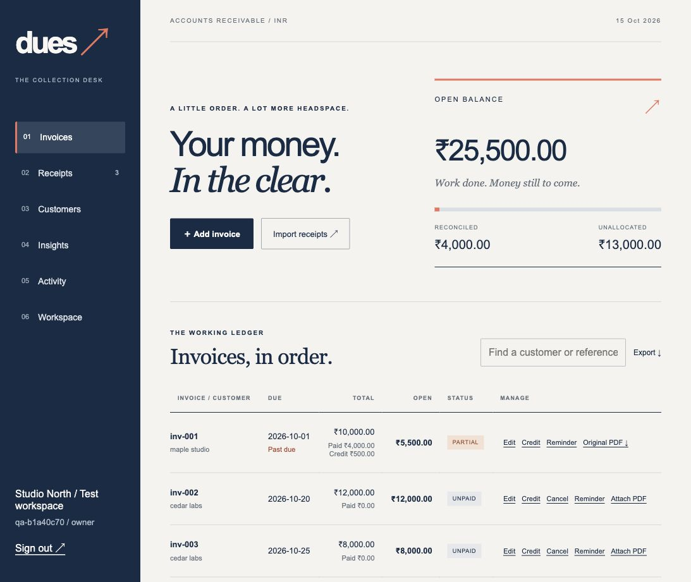

# Dues ↗

**A calmer collection desk for invoices, receipts, and the money between them.**

Dues is a standalone INR receivables app for freelancers and small service businesses. Import invoices and receipts, review payment matches, and keep an auditable record of what is still due.



## What it does

- **Private workspaces:** account login, owner/editor/viewer roles, invitations, session revocation and one-use recovery codes.
- **Invoice management:** PDF extraction, local scanned-PDF OCR, CSV column mapping and reviewed imports, editing, cancellation, original attachments and credit notes.
- **Payment reconciliation:** partial payments, exact-ID duplicate prevention, possible-duplicate review, split allocations, reversals and refund recording.
- **Recurring invoices:** weekly/monthly schedules, month-end handling and idempotent catch-up while the app runs.
- **Reviewed reminders:** customer contacts, editable drafts and an outbox. Local mode simulates delivery; configured SMTP requires review before sending.
- **Visibility and recovery:** aging reports, customer balances, CSV exports, audit records, storage limits and encrypted backup/restore.

## Run locally

Requires Python 3.14. From this folder:

```sh
sh start.sh
```

Open **http://127.0.0.1:8120** and create your own workspace. Passwords must be at least 12 characters. No real credentials or business records are included. Sample files contain fictional data.

For on-device OCR on macOS (requires Swift command-line tools):

```sh
sh scripts/setup-ocr.sh
```

Linux OCR uses Poppler and Tesseract; both are included in the Docker image. OCR is best-effort, limited to three scanned pages, and extracted fields always require review.

## Try the workflow

1. Download/import `samples/invoices.csv` and inspect the preview before confirming.
2. Import `samples/payments.csv`: four distinct receipts and one duplicate row.
3. Review the INR 4,000 payment against the INR 10,000 invoice: INR 6,000 remains.
4. Allocate the INR 6,000 balance payment: the invoice becomes paid.
5. Reimport the receipt file: existing transaction IDs are skipped without changing balances.
6. Add a customer email and queue a reminder on an open invoice. **Local mode sends no email.**

## Tests

```sh
.venv/bin/python -m pytest -q
node --check static/app.js
```

**37 tests passed in the development verification**, covering isolation, roles, payment invariants, duplicate handling, concurrency, recurrence, recovery, reviewed delivery, OCR, quotas and authenticated encrypted backup recovery. The complete suite requires the OCR runtime. A network-isolated Linux container also passed health, registration and OCR smoke tests.

## Stack and design

FastAPI · SQLite · Python · Plain JavaScript/CSS · Apple Vision or Tesseract · Cryptography/Fernet · Docker/Caddy.

The interface uses an ink-blue navigation rail, coral highlights, open ledgers and editorial typography instead of a grid of statistic cards. Built with AI-assisted development.

## Backups and deployment

See [the deployment guide](deploy/README.md) for a controlled private rollout, HTTPS configuration, SMTP, storage limits and encrypted snapshots. Generate and store your own `DUES_BACKUP_KEY` privately; keep a separate offline copy. Never commit `.env`, data directories or backup files.

## Honest scope

This is a working local project, **not a certified accounting service or an independently audited public SaaS**. It does not move money, connect directly to banks or calculate/file GST. Banking input is CSV. Email delivery requires your own SMTP provider. Public self-signup stays disabled in deployment mode until verified-email registration and abuse protection are implemented. There is no public hosted demo.

Tests are evidence for supported workflows, not a guarantee of correctness or security. Read the deployment guide before using real business data.
